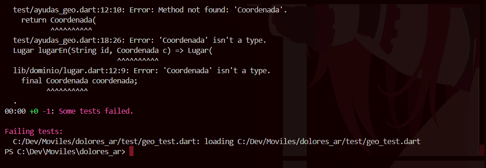
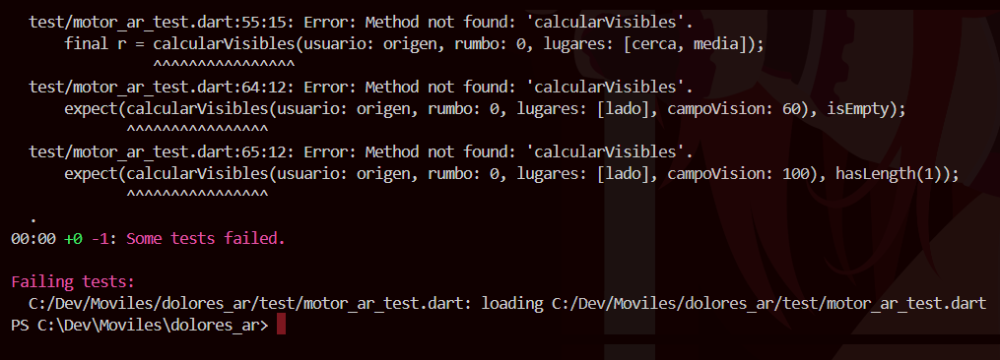
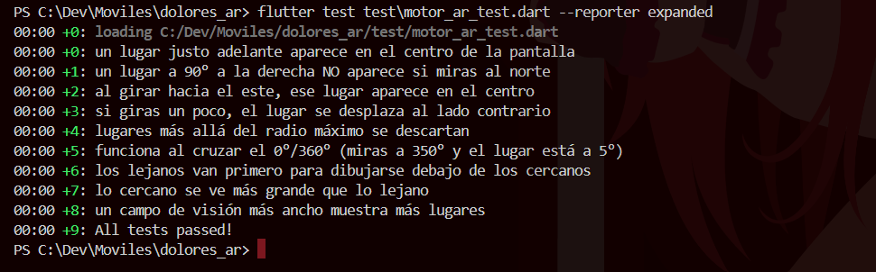
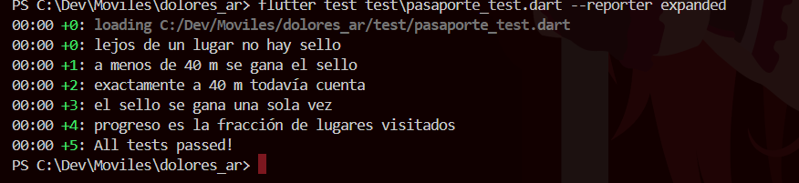
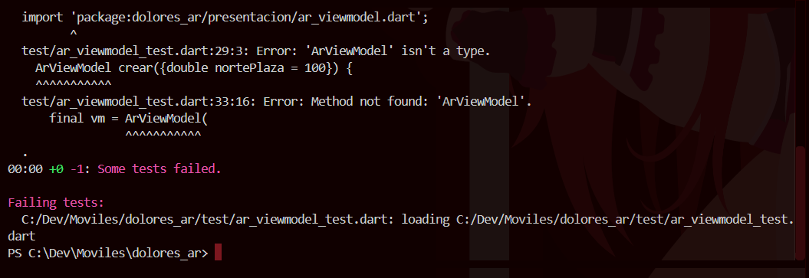

# Dolores AR

App turística con realidad aumentada para visitar Dolores Hidalgo.
Desarrollo Móvil Integral · UTNG · Prof. Anastacio Rodríguez García

**Alumno:** Omar Mendez · **Grupo:** GTID232

## Evidencias por ronda

| Ronda | Qué se prueba | Tests | ROJO | VERDE |
|---|---|---|---|---|
| 1 | Distancia (Haversine) | 4 |  |  |
| 2 | Rumbo y ángulos | 10 |  |  |
| 3 | Campo de visión y formato | 6 |  |  |
| 4 | Motor de realidad aumentada | 9 |  |  |
| 5 | Pasaporte turístico | 5 |  |  |
| 6 | ViewModel | 8 |  |  |

## Ejecución completa

Los 42 tests juntos:

## Interfaz

Pantalla de inicio: acceso a la exploración con GPS real, al modo demo, al
modelo 3D y la lista de lugares del recorrido.

