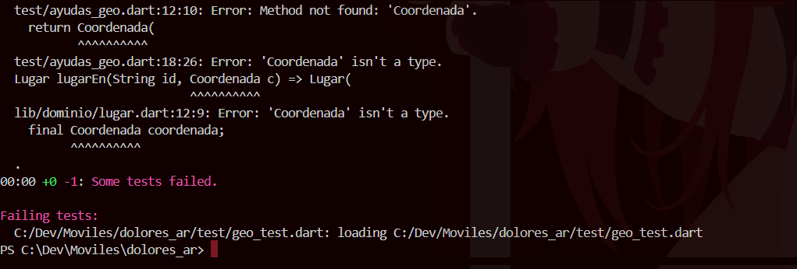
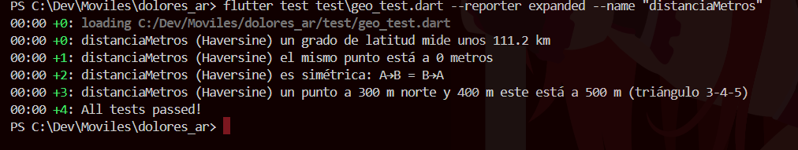
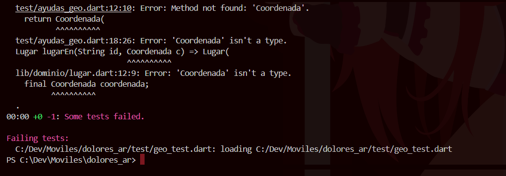
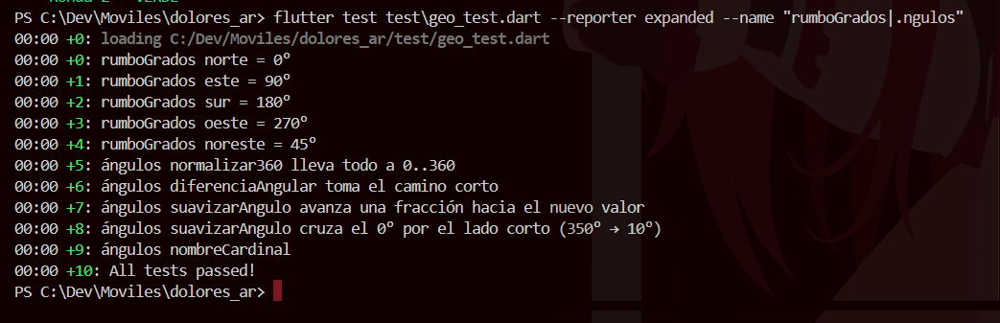
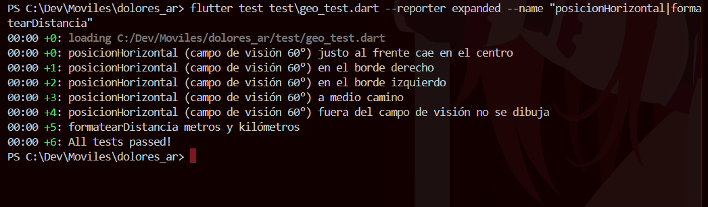
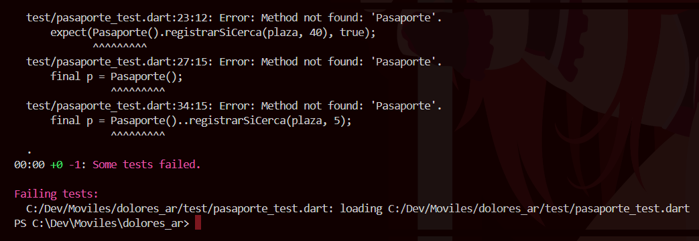
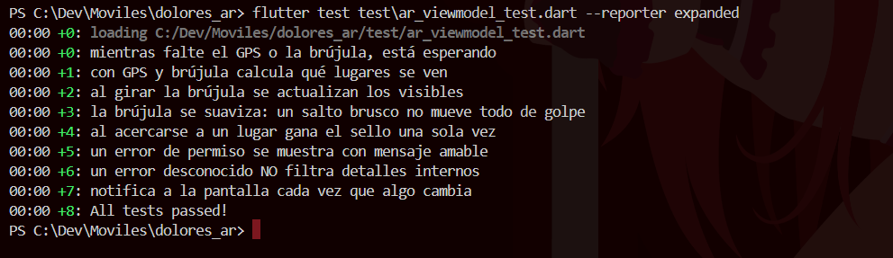
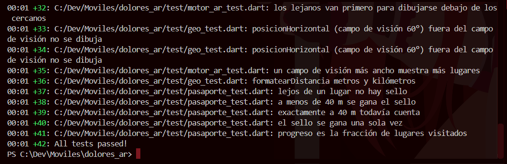
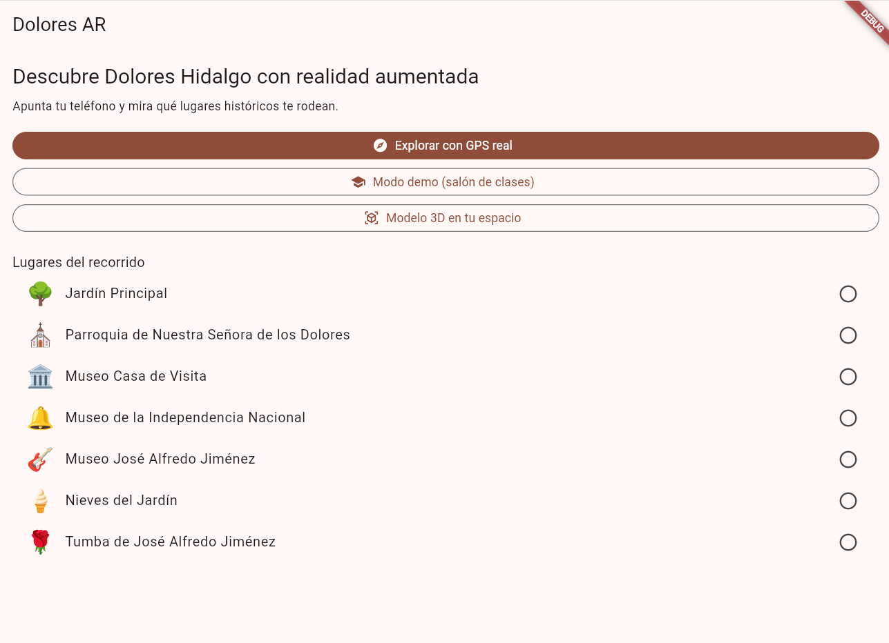

# Dolores AR

App turística con realidad aumentada para visitar Dolores Hidalgo.

**Alumno:** Omar Mendez · **Grupo:** GTID243

## Evidencias por ronda

### Ronda 1. Distancia (Haversine)

**Tests:** 4

**ROJO**

**VERDE**

---

### Ronda 2. Rumbo y ángulos

**Tests:** 10

**ROJO**

**VERDE**

---

### Ronda 3. Campo de visión y formato

**Tests:** 6

**ROJO**

**VERDE**

---

### Ronda 4. Motor de realidad aumentada

**Tests:** 9

**ROJO**

**VERDE**

---

### Ronda 5. Pasaporte turístico

**Tests:** 5

**ROJO**

**VERDE**

---

### Ronda 6. ViewModel

**Tests:** 8

**ROJO**

**VERDE**

---

## Ejecución completa

Los 42 tests juntos:

## Interfaz

Pantalla de inicio: acceso a la exploración con GPS real, al modo demo, al modelo 3D y a la lista de lugares del recorrido.

